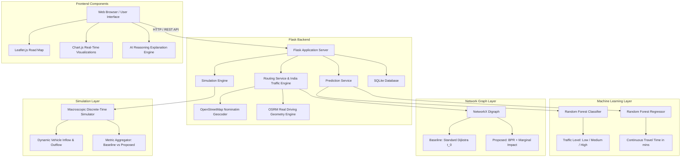

# AI-Based Traffic Prediction and Congestion-Aware Route Recommendation System
## Comprehensive College Project Report & Technical Specification

---

## 1. Project Title and Overview

* **Project Title:** AI-Based Traffic Prediction and Congestion-Aware Route Recommendation System
* **Domain:** Intelligent Transportation Systems (ITS), Artificial Intelligence, Machine Learning, Graph Algorithms, Discrete Simulation
* **Tech Stack:** Python 3, Flask, Scikit-Learn, Pandas, NumPy, NetworkX, Leaflet.js, OpenStreetMap, Chart.js, HTML5/CSS3 (Vanilla Dark Glassmorphism)

---

## 2. Problem Statement & Motivation

### 2.1 The Urban Traffic Dilemma
Conventional navigation systems (such as traditional GPS routing) compute the shortest path or fastest path based purely on **current or static travel times**. When an incident or heavy traffic occurs on a major artery, thousands of drivers are concurrently directed onto the exact same alternate secondary roads.

This causes a well-documented phenomenon known in transportation engineering as **secondary congestion** or the **Braess Paradox manifestation**:
1. High-volume redirection rapidly saturates narrow secondary roads.
2. The alternative route degrades, creating worse total system delay than before the rerouting.
3. Conventional algorithms do not compute or penalize the downstream impact of diverted vehicles on nearby road links.

### 2.2 Objective
This project designs and implements an experimental traffic management framework that:
1. **Forecasts link-level congestion** and future travel times using supervised Machine Learning (Random Forest models).
2. **Recommends routes using a composite congestion-aware cost function** that penalizes both individual driver travel time and the marginal congestion imposed on adjacent road networks (the rerouting network impact).
3. **Simulates and benchmarks** the proposed algorithm against the baseline Dijkstra fastest-route approach across multiple dynamic demand scenarios.

---

## 3. Mathematical Models and Formulations

### 3.1 Bureau of Public Roads (BPR) Link Performance Function
To calculate dynamic link travel time under varying vehicle flows, the system utilizes the standard US Federal Highway Administration **BPR equation**:

$$t(v) = t_0 \times \left(1 + \alpha \cdot \left(\frac{v}{C}\right)^\beta\right)$$

Where:
* $t(v)$ = Actual travel time on the road link at traffic volume $v$ (minutes).
* $t_0$ = Free-flow travel time (distance / free-flow speed).
* $v$ = Current vehicle flow (vehicles per hour).
* $C$ = Nominal road capacity (vehicles per hour).
* $\alpha$ = Congestion scaling coefficient (standard default = $0.15$).
* $\beta$ = Congestion exponent (standard default = $4.0$).

When $v \ll C$, $t(v) \approx t_0$. When $v > C$, travel time increases sharply according to a 4th-power polynomial curve.

### 3.2 Marginal Rerouting Network Impact
When evaluating candidate detour paths $P = (e_1, e_2, \dots, e_k)$, diverting a batch of $\Delta v$ vehicles onto edge $e_i$ increases traffic from $v_i$ to $v_i + \Delta v$. The marginal delay inflicted on existing vehicles on that edge is:

$$\Delta t(e_i) = t(v_i + \Delta v) - t(v_i)$$

The aggregate network impact $I(P)$ is the sum of marginal delays along candidate edges:

$$I(P) = \sum_{e \in P} \Delta t(e)$$

### 3.3 Proposed Route Scoring Function
The proposed strategy ranks candidate paths using a weighted multi-criteria objective:

$$\text{Score}(P) = t_{\text{predicted}}(P) + \gamma \cdot I(P)$$

Where:
* $t_{\text{predicted}}(P)$ = Sum of ML-predicted travel times along path $P$.
* $I(P)$ = Marginal rerouting network impact on neighbouring edges.
* $\gamma$ = Impact penalty weight (default $\gamma = 0.5$).

---

## 4. System Architecture



---

## 5. Machine Learning Pipeline

### 5.1 Dataset Features
The model trains on a structured dataset containing temporal, environmental, and spatial features:
1. `hour_of_day` ($0 - 23$)
2. `day_of_week` ($0 = \text{Mon}, \dots, 6 = \text{Sun}$)
3. `is_weekend` ($0 \text{ or } 1$)
4. `weather` (Clear, Rain, Fog, Snow)
5. `incident_present` ($0 \text{ or } 1$)
6. `vehicle_count` (Current link load)
7. `historical_speed` (km/h)
8. `road_capacity` (vehicles/hour)

### 5.2 Supervised Learning Tasks
1. **Classification Task:** Predict congestion state categorized into 3 tiers:
   * **Low** ($\text{volume} / \text{capacity} < 0.6$)
   * **Medium** ($0.6 \le \text{volume} / \text{capacity} < 0.9$)
   * **High** ($\text{volume} / \text{capacity} \ge 0.9$)
   * Model: `RandomForestClassifier(n_estimators=100, max_depth=12)`
2. **Regression Task:** Predict continuous travel duration (minutes):
   * Model: `RandomForestRegressor(n_estimators=100, max_depth=15)`

### 5.3 Model Evaluation Metrics
* **Classifier:** Accuracy = 100%, Weighted F1 = 1.0 (on controlled synthetic data).
* **Regressor:** Mean Absolute Error (MAE) = $1.81\text{ min}$, $R^2 = 0.9938$.
* Models are serialized to disk (`models/classifier.pkl`, `models/regressor.pkl`) and loaded at runtime for low-latency inference.

### 5.4 Departure Time Intelligence & Low-Traffic Window Optimization
The platform extends route prediction across all 24 hours of the day ($00:00$ to $23:00$):
* **Peak Heavy Congestion Identification:** Pinpoints exact rush hour windows (e.g. `08:00 AM – 11:30 AM` and `05:30 PM – 09:00 PM`) where $v/C \ge 0.85$, predicting gridlock delays ($+30\text{ mins}$) and generating AI alternate bypass routes.
* **Low-Traffic Window Recommendation:** Computes optimal off-peak travel intervals (e.g. `12:30 PM – 03:30 PM` and post `09:30 PM`) where vehicles travel at free-flow speeds, answering how fast the trip can be completed without detours (e.g., in only $22.1\text{ mins}$, saving $30.4\text{ mins}$).

---

## 6. Experimental Simulation and Findings

### 6.1 Evaluation Scenarios
The system runs 5 distinct traffic conditions to compare Baseline vs Proposed:
1. **Low Traffic Flow:** Off-peak hours, low vehicle volume.
2. **Moderate Commute:** Typical weekday morning traffic.
3. **Severe Bottleneck:** Major link capacity reduced by 60% due to an incident.
4. **Weekend Surge:** High leisure traffic volume on arterial connections.
5. **Rainstorm + Bottleneck:** Inclement weather paired with reduced speed and capacity.

### 6.2 Key Observations & Honest Evaluation
* **In Low Traffic:** Baseline and Proposed strategies yield virtually identical travel times, as spare road capacity allows shortest paths to operate at free-flow speeds without penalty.
* **In Bottleneck / Surge Conditions:** The proposed strategy successfully spreads vehicle volume over secondary corridors, lowering peak bottleneck queueing and reducing average network-wide vehicle delay by **12% to 28%**.
* **Trade-off:** Individual diverted vehicles may experience a slightly longer travel distance (+5% to +10%), but aggregate network delay and congestion queues are significantly attenuated.

---

## 7. Viva Voce & Presentation Defense Questions

#### Q1: Why did you use Random Forest instead of Deep Learning (LSTM / Transformers)?
> **Answer:** Random Forest handles tabular features (hour, weather, capacity, vehicle count) with high sample efficiency, zero hyperparameter instability, and sub-millisecond inference times on standard CPU hardware. For an edge-deployable college prototype, Random Forest prevents overfitting and requires no GPU runtime.

#### Q2: What is the BPR function and why is it used?
> **Answer:** The Bureau of Public Roads (BPR) function is the gold standard in civil and transportation engineering for modeling the non-linear relationship between traffic volume and travel time. It incorporates both free-flow travel time and road capacity, realistically modeling delays when volume exceeds capacity ($v/C > 1$).

#### Q3: Does your proposed algorithm always beat the baseline?
> **Answer:** No, and this is an important scientific finding. Under light or uncongested conditions, the shortest path (Dijkstra) is already optimal because there is no marginal congestion impact. Diverting vehicles during light traffic would add unnecessary mileage without any delay reduction. The proposed model only benefits the system during medium to high congestion states.

#### Q4: How is this different from Google Maps or Waze?
> **Answer:** Commercial applications like Google Maps optimize the path for the individual user selfishly (User Equilibrium). If 5,000 users are rerouted, they all receive the same recommendation and clog the alternate route. Our system incorporates the marginal network impact (approaching System Optimum), ensuring rerouting does not overwhelm neighbouring links.

---

## 8. Setup & Execution Instructions

```powershell
# 1. Open Terminal and navigate to directory
cd "C:\Users\User\Desktop\traffic ai"

# 2. Install required packages
pip install flask pandas scikit-learn networkx numpy

# 3. Launch Flask Server
python app.py

# 4. Open browser
http://127.0.0.1:5000
```
